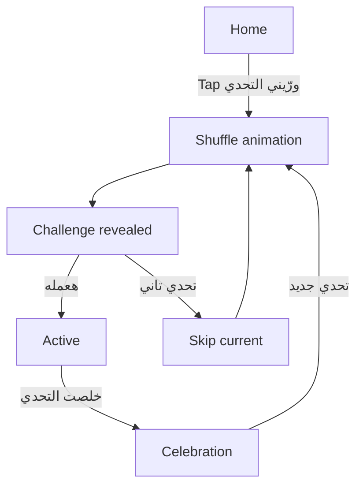

# 03 — UX Flows & Screen Specification

**Version:** 1.0  
**Design direction:** Playful Minimal / Light Mode  
**Primary language:** Egyptian Arabic (`ar-EG`)

## 1. UX principles

- Start playing immediately; no signup, onboarding carousel, or setup form.
- The first screen has one obvious action.
- The challenge is the visual focal point after reveal.
- Keep supporting information secondary: category, time, difficulty, and optional safety note.
- Skipping is neutral, not a failure state.
- The app should feel like a tiny game, not a task manager.

## 2. Information architecture

MVP contains only three practical views/states:

1. **Home** — invitation to play and primary CTA.
2. **Challenge** — reveal, read, start, skip, complete.
3. **Completion** — short celebration and next-challenge CTA.

A lightweight history/count can appear as a secondary text detail, not a separate dashboard.

## 3. Screen specifications

### Screen A — Home

**Content hierarchy**
1. Temporary wordmark placeholder (do not finalize a product name).
2. Heading: “زهقان؟” or “يلا نلعب؟” — test one, do not stack both.
3. Supporting line: “اضغط وخد تحدي عشوائي بسيط.”
4. Main button: “ورّيني التحدي”.
5. Small reassurance: “100 تحدي • من غير تسجيل”.
6. Decorative animated elements: slow floating stars/shapes, only if reduced-motion is not enabled.

**Primary action:** draw and reveal a challenge.

### Screen B — Revealing

- Keep the selected challenge fixed in application state before animation begins.
- Animate a deck/card shuffle or slot-like card movement for approximately 900–1400 ms.
- Show a short label such as “بنختار لك تحدي...”.
- Do not fake multiple random draws in the business logic; visual cards may be decorative placeholders.
- Provide a way to cancel only if the animation is long; otherwise keep this transition short.

### Screen C — Challenge revealed

**Content hierarchy**
1. Category pill using its category accent color.
2. Main challenge title.
3. One- or two-sentence description.
4. Estimated time and difficulty as quiet metadata.
5. Safety note only when populated.
6. Primary action: “هعمله”.
7. Secondary action: “تحدي تاني”.

Avoid adding social actions or user-submitted challenge controls.

### Screen D — Active / completion

The “هعمله” action can simply acknowledge the challenge and change the primary button to “خلصت التحدي”. Do not introduce a timer or a blocking checklist. When the user marks it complete:
- Trigger a brief confetti / sparkle animation.
- Show “خلصته! عاش 👏”.
- Show a small completed count if implemented.
- Offer “تحدي جديد”.

### Screen E — Skip / next challenge

- “تحدي تاني” dismisses the current item and draws the next one.
- Do not show warning copy, lost points, streak reset, or guilt-based messaging.
- The skipped item remains consumed for the current shuffle cycle.

## 4. User flow diagram

## 5. Responsive behavior

- Mobile-first; use a centered content column with a readable max width around 520–600 px.
- On narrow screens, challenge card fills available width with 16–20 px outer padding.
- On desktop, keep the game centered; do not stretch content edge-to-edge.
- Buttons should have at least 44 × 44 CSS px interactive area.
- Keep important content above the fold on common mobile viewport heights.

## 6. Interaction copy

| State | Arabic copy |
|---|---|
| Home CTA | ورّيني التحدي |
| Loading / reveal | بنختار لك تحدي... |
| Start | هعمله |
| Complete | خلصت التحدي |
| Skip | تحدي تاني |
| Success | خلصته! عاش 👏 |
| Next | تحدي جديد |
| No storage | تقدر تلعب عادي، بس تقدمك مش هيتحفظ على الجهاز ده. |

## 7. UX edge cases

- **Rapid taps:** disable the main CTA while reveal animation is running.
- **Refresh during reveal:** persist the already-selected challenge so it can be restored as revealed, or restart the reveal for that same selected ID; never draw a second item accidentally.
- **Empty / corrupt localStorage:** rebuild a valid shuffled bag and continue.
- **Library version changes:** validate IDs; reset stale bag state safely while preserving only valid history items.
- **Reduced motion:** show a short fade or immediate card reveal.
- **All challenges in cycle consumed:** automatically build the next shuffled cycle.
- **User skips repeatedly:** allow it; no warning, penalty, or lockout.

## 8. Visual QA checklist

- [ ] The main CTA is the strongest visual element on Home.
- [ ] Challenge title is readable at a glance.
- [ ] Category color does not reduce text contrast.
- [ ] There is no dark-mode styling.
- [ ] Mobile layout does not require horizontal scrolling.
- [ ] Skip is visible but visually secondary to the main action.
- [ ] Success animation is brief and does not block the next action.
